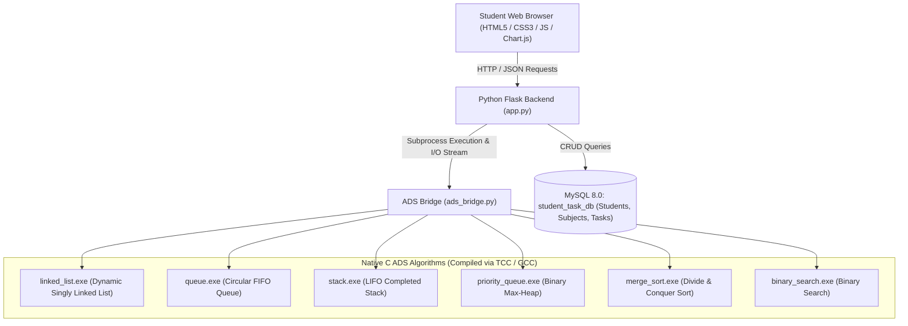
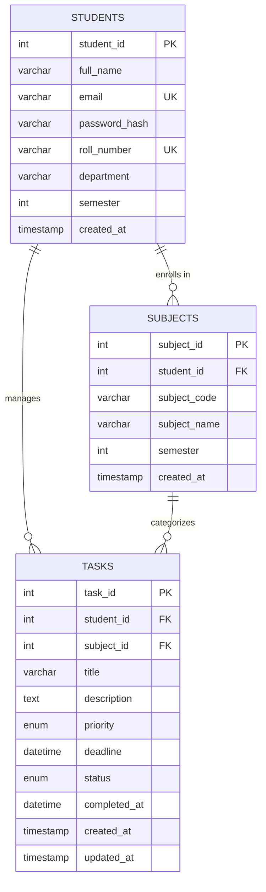

# STUDENT TASK AND DEADLINE MANAGEMENT SYSTEM
## Advanced Data Structures (ADS) - Project Based Learning (PBL) Report

---

### 1. Project Abstract & Objectives
In academic environments, students face significant cognitive overload managing coursework, laboratory assignments, semester milestones, and project deadlines across multiple subjects. The **Student Task and Deadline Management System** is a full-stack academic workflow platform designed specifically as an Advanced Data Structures (ADS) Project-Based Learning implementation.

Unlike standard CRUD web apps, this system implements core data management and algorithmic operations in native **C language** source files, compiles them to native machine code, and interfaces with a **Python Flask** backend and a normalized **MySQL** database.

#### Core Objectives:
1. Provide a student dashboard with task tracking, status management, priority allocation, and deadline notifications.
2. Implement **six mandatory ADS algorithms** in pure C:
   - Dynamic Singly Linked List
   - Circular FIFO Queue
   - LIFO Task Completion Stack
   - Binary Max-Heap Priority Queue
   - Divide-and-Conquer Merge Sort
   - Binary Search on Sorted Task IDs
3. Seamlessly connect the compiled C algorithm binaries to the web application via an automated bridge.
4. Provide an interactive **ADS Algorithms Demonstration Hub** where students and evaluators can run and visualize each algorithm's operations, step-by-step traces, and time complexities.

---

### 2. Architecture & Technology Stack

---

### 3. Database Schema & Relational Model

The system utilizes MySQL 8.0 database `student_task_db` with three strongly-typed tables:

---

### 4. Comprehensive Analysis of the Six C ADS Algorithms

#### Algorithm 1: Dynamic Singly Linked List (`algorithms/linked_list.c`)
- **ADS Concept**: Dynamic heap memory allocation (`malloc`, `free`) with pointer-based node linking (`struct TaskNode* next`).
- **Application in System**: Manages dynamic collections of tasks without pre-allocating contiguous memory. Supports dynamic task insertion, deletion by ID, and sequential display.
- **Complexity Analysis**:
  - Insertion at Head: $\mathcal{O}(1)$
  - Insertion at Tail (with tail pointer): $\mathcal{O}(1)$
  - Deletion by ID: $\mathcal{O}(n)$ (linear traversal to locate node and rewire pointers)
  - Traversal & Display: $\mathcal{O}(n)$
  - Auxiliary Space: $\mathcal{O}(n)$ for node allocation

#### Algorithm 2: Circular FIFO Queue (`algorithms/queue.c`)
- **ADS Concept**: First-In, First-Out (FIFO) queue utilizing circular array arithmetic `index = (index + 1) % MAX_CAPACITY` to avoid memory drift.
- **Application in System**: Manages pending tasks scheduled for immediate execution. New tasks enter at `rear`; next task to execute leaves from `front`.
- **Complexity Analysis**:
  - Enqueue: $\mathcal{O}(1)$
  - Dequeue: $\mathcal{O}(1)$
  - Peek Front: $\mathcal{O}(1)$
  - Space: $\mathcal{O}(\text{CAPACITY})$ bounded array

#### Algorithm 3: LIFO Stack (`algorithms/stack.c`)
- **ADS Concept**: Last-In, First-Out (LIFO) stack maintaining a top-of-stack pointer.
- **Application in System**: Tracks recently completed tasks and provides an **Undo Completion** mechanism. When a user marks a task completed, it is pushed onto the stack. The user can pop the top element to reopen the most recently completed task.
- **Complexity Analysis**:
  - Push: $\mathcal{O}(1)$
  - Pop: $\mathcal{O}(1)$
  - Peek: $\mathcal{O}(1)$
  - Space: $\mathcal{O}(\text{CAPACITY})$

#### Algorithm 4: Binary Max-Heap Priority Queue (`algorithms/priority_queue.c`)
- **ADS Concept**: Complete binary tree implemented in a 1D array where parent node key $\ge$ children keys (`tree[(i - 1) / 2] >= tree[i]`).
  - Score mapping: High Priority = 3, Medium Priority = 2, Low Priority = 1.
  - **Composite Comparison with Nearest Deadline Tie-Breaker**:
    - Primary Order: Priority score (High=3 > Medium=2 > Low=1).
    - Secondary Order: When two tasks share equal priority, their deadlines are compared chronologically, and the task with the nearest (earliest) deadline is ordered first.
    - Tertiary Order: Smaller task ID for deterministic behavior.
- **Application in System**: Arranges tasks based on priority so high-priority academic tasks always appear first. When multiple tasks have equal priority, the most urgent deadline is prioritized at the top of the schedule.
- **Complexity Analysis**:
  - Insertion (Sift-Up): $\mathcal{O}(\log n)$
  - Extract-Max (Sift-Down): $\mathcal{O}(\log n)$
  - Peek Max (Root): $\mathcal{O}(1)$
  - Complete Priority Sorting (HeapSort): $\mathcal{O}(n \log n)$
  - Space: $\mathcal{O}(n)$

#### Algorithm 5: Divide-and-Conquer Merge Sort (`algorithms/merge_sort.c`)
- **ADS Concept**: Divide and conquer recursive sorting:
  1. **Divide**: Split task array of size $n$ into two halves of size $n/2$.
  2. **Conquer**: Recursively sort each half.
  3. **Combine**: Merge the two sorted subarrays in linear $\mathcal{O}(n)$ time using two pointers.
- **Recurrence Relation**: $T(n) = 2T(n/2) + \mathcal{O}(n) \implies \mathcal{O}(n \log n)$ by Master Theorem.
- **Application in System**: Chronologically sorts student tasks by deadline dates. Guarantees stable $\mathcal{O}(n \log n)$ performance across all data distributions.
- **Complexity Analysis**:
  - Best Case: $\mathcal{O}(n \log n)$
  - Average Case: $\mathcal{O}(n \log n)$
  - Worst Case: $\mathcal{O}(n \log n)$
  - Auxiliary Space: $\mathcal{O}(n)$

#### Algorithm 6: Binary Search on Sorted Task IDs (`algorithms/binary_search.c`)
- **ADS Concept**: Iterative halving of search space:
  - Precondition: Array must be sorted by `task_id`.
  - Midpoint: $mid = low + \lfloor(high - low) / 2\rfloor$.
  - Compares target ID with midpoint ID, eliminating half the remaining candidate keys at each step.
- **Application in System**: Enables instant retrieval of any task record by its unique Task ID.
- **Complexity Analysis**:
  - Best Case: $\mathcal{O}(1)$ (target located at initial midpoint)
  - Average Case: $\mathcal{O}(\log n)$
  - Worst Case: $\mathcal{O}(\log n)$
  - Space: $\mathcal{O}(1)$ iterative

---

### 5. Summary Table of ADS Complexities

| Algorithm | Data Structure | Operation | Best Case | Average Case | Worst Case | Auxiliary Space |
| :--- | :--- | :--- | :---: | :---: | :---: | :---: |
| **Linked List** | Dynamic Nodes | Insert / Delete | $\mathcal{O}(1)$ / $\mathcal{O}(1)$ | $\mathcal{O}(1)$ / $\mathcal{O}(n)$ | $\mathcal{O}(1)$ / $\mathcal{O}(n)$ | $\mathcal{O}(n)$ dynamic |
| **FIFO Queue** | Circular Array | Enqueue / Dequeue | $\mathcal{O}(1)$ | $\mathcal{O}(1)$ | $\mathcal{O}(1)$ | $\mathcal{O}(CAP)$ |
| **LIFO Stack** | Top-indexed Array | Push / Pop | $\mathcal{O}(1)$ | $\mathcal{O}(1)$ | $\mathcal{O}(1)$ | $\mathcal{O}(CAP)$ |
| **Priority Queue** | Binary Max-Heap | Insert / Extract-Max | $\mathcal{O}(1)$ / $\mathcal{O}(\log n)$ | $\mathcal{O}(\log n)$ | $\mathcal{O}(\log n)$ | $\mathcal{O}(n)$ |
| **Merge Sort** | Subarray Recursion | Chronological Sort | $\mathcal{O}(n \log n)$ | $\mathcal{O}(n \log n)$ | $\mathcal{O}(n \log n)$ | $\mathcal{O}(n)$ |
| **Binary Search** | Sorted Array | Search by Task ID | $\mathcal{O}(1)$ | $\mathcal{O}(\log n)$ | $\mathcal{O}(\log n)$ | $\mathcal{O}(1)$ |

---

### 6. C to Python Subprocess Integration Design

Rather than simulating data structures in Python, the backend leverages compiled C binaries:
1. `algorithms/compile_algorithms.py` automatically detects GCC or TCC and compiles all 6 C files into `algorithms/bin/*.exe`.
2. `backend/ads_bridge.py` serializes relational task records into formatted batch arguments:
   `"<task_id>|<title>|<priority>|<deadline>|<status>;..."`
3. The C binary executes the pure C algorithmic logic and prints a structured JSON response stream to `stdout`.
4. The Python bridge parses this stream and passes the resulting arrays, execution metrics, and step-by-step traces to Flask templates and REST API endpoints.

---

### 7. Evaluation & Test Results

All six C algorithms and web workflows have been verified:
- **C Compilation**: 6/6 binaries compiled with 0 errors.
- **MySQL Connection**: Connected to local `student_task_db`, foreign keys active.
- **Task CRUD**: Add, edit, toggle complete, and delete verified.
- **Merge Sort**: Verified chronological deadline ordering with merge operation counts.
- **Priority Queue**: Verified High priority tasks (score 3) ordered above Medium (2) and Low (1).
- **Binary Search**: Verified exact trace and comparison counts matching $\log_2(n)$ bound.

